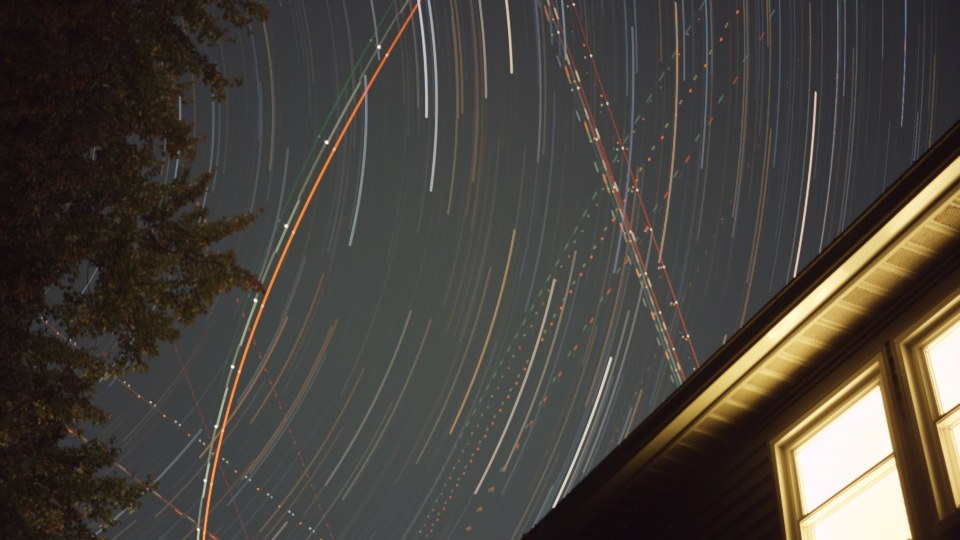
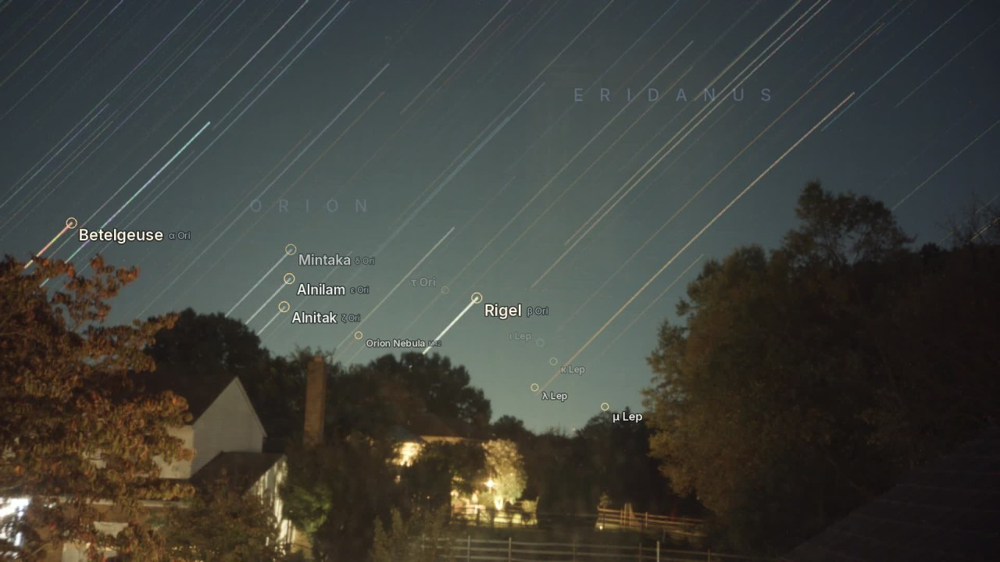

# deplane

Star-trail stacker for the raw FITS frames produced by the DWARF smart telescope's
*Star Trails* mode, with aircraft and satellite trails removed. It produces a stacked
image and a time-lapse movie of the trails building up, like the ones the DWARF makes
itself, but without the planes.

| DWARF-style max stack | deplane |
| --- | --- |
|  |  |

## Install

Requires [uv](https://docs.astral.sh/uv/) and `ffmpeg` on the `PATH`.

```sh
uv sync
```

## Usage

Point it at a DWARF star-trails folder (the one containing `startrails_*.fits`):

```sh
uv run python deplane.py /path/to/STARTRAILS_DWARF_RAW_WIDE_... -o out
```

This writes to `out/`:

| File | Contents |
| --- | --- |
| `stack.jpg`, `stack.png` | stretched star-trail stack |
| `stack_linear16.tif` | unstretched 16-bit RGB stack, for further processing elsewhere |
| `startrails.mp4` | time-lapse of the trails building up |
| `masks.mp4` | (with `--mask-video`) each raw frame with the removed pixels shown in red |

With `--labels` (see [Star labels](#star-labels)) it also writes:

| File | Contents |
| --- | --- |
| `startrails_labeled.mp4` | the same movie with fading star (and constellation) names |
| `stack_labeled.jpg` | the still stack with each identified star labelled along its trail |
| `solution.json` | fitted camera/sky model, residuals, and each labelled star's first/last visible frame |
| `solve_check.jpg` | reference frame with detections (green) and predicted catalog stars (rings) |

All frames are held in memory along with their masks and cleaned copies: a
451-frame 1920x1080 session needs about 7 GB of RAM, and a 1440-frame one about 21 GB.

### Examples

```sh
# comet-style movie: trails fade with a half-life of 20 frames
uv run python deplane.py SESSION -o out_fade --fade 20

# plain max stack without plane removal, for comparison
uv run python deplane.py SESSION -o out_raw --no-clean

# only frames 0-315, still image only
uv run python deplane.py SESSION --last 316 --no-video

# check what is being removed
uv run python deplane.py SESSION --mask-video

# name the stars as they appear, plus constellation captions
uv run python deplane.py SESSION --labels --constellations --lat 39.05
```

### Options

| Option | Default | Description |
| --- | --- | --- |
| `-o, --out` | `out` | output folder |
| `--first`, `--last` | all | frame range (Python slice indices into the sorted files) |
| `--sigma` | 4 | detection threshold in sky-noise sigmas; lower catches fainter planes but risks nibbling faint stars |
| `--star-motion` | 3 | max star drift between frames, in half-res pixels |
| `--grow` | 3 | how far to grow each detection, in half-res pixels |
| `--min-area` | 3 | smallest detection kept, in half-res pixels (filters twinkle and hot pixels) |
| `--no-clean` | | skip plane removal |
| `--sky` | 0.25 | output sky brightness, 0-1 |
| `--white` | 99.95 | white-point percentile |
| `--saturation` | 1.3 | colour saturation |
| `--fade` | 0 | movie trail half-life in frames; 0 means trails never fade |
| `--fps` | 30 | movie frame rate |
| `--no-video` | | skip the movie |
| `--mask-video` | | also write `masks.mp4` |
| `--labels` | | identify the stars and write the labelled outputs |
| `--lat` | 39.05 | site latitude in degrees; only used for atmospheric refraction |
| `--label-mag` | 4.75 | faintest magnitude to label |
| `--label-hold` | 2.5 | seconds a label stays fully visible (brighter stars a little longer) |
| `--constellations` | | also fade constellation names in and out |
| `--font` | bundled Inter | font file to use for labels |

## How it works

1. **Load.** The raw Bayer frames (BGGR, 16-bit) are read with astropy.
2. **Detect transients.** Between consecutive 10 s frames a star moves only a pixel or
   two, but a plane crosses a large part of the field or blinks on and off. Each frame
   is compared with the max of its neighbours, dilated by `--star-motion`. Pixels much
   brighter than that are transients. Detection runs on a half-resolution luminance image
   (each 2x2 Bayer cell summed), and blobs smaller than `--min-area` are discarded.
3. **Clean.** Masked pixels are replaced with the per-pixel median of the nearby frames,
   i.e. the sky behind the plane.
4. **Stack.** The cleaned frames are max-stacked, then debayered.
5. **Stretch.** The sky is white-balanced to neutral grey, then a midtones transfer
   function (as in PixInsight and Siril) puts the sky at `--sky`. The curve is fixed
   from the final stack, so the movie doesn't flicker.
6. **Movie.** A running max of the cleaned frames is written to ffmpeg (H.264). With
   `--fade`, the brightness each pixel has above the current frame decays every frame,
   so trails fade into the current sky rather than to black.

## Star labels



With `--labels`, deplane works out which stars are in the session and gives each one a
name tag that follows it for a few seconds as it appears, then fades out. It needs no
network access or manual input. The code is in `starlabels.py`:

1. **Detect** point sources in every cleaned frame. Static sources (hot pixels, ground
   lights) and ones that don't persist from frame to frame (flickering foliage, plane
   strobes) are dropped.
2. **Plate-solve** one frame by matching triangles of bright stars against the catalog,
   using the scale from the FITS focal length and pixel size.
3. **Fit** a model of a fixed camera under a rotating sky (pointing, roll, focal length,
   optical centre, radial distortion, refraction) to the stars matched across the whole
   session. Frame times come from `DATE-OBS`, so the rotation rate is the sidereal rate.
   The sky's rotation angle and the camera's orientation can only be told apart by
   refraction, so the angle is chosen by a scan; for a field far above the horizon a level
   camera is assumed instead. This changes the reported pointing, not where labels go.
4. **Visibility:** each catalog star counts as visible in a frame when a detection is near
   its predicted position. It's labelled when it first stays visible for a second (stars
   rising over trees, passing behind them, or leaving the frame are handled this way).
5. **Schedule** labels so they never overlap, brightest stars first, with at most 15 on
   screen. Proper names are shown only when they are official IAU names; otherwise the
   Bayer or Flamsteed designation is used.

On the reference session (1440 frames, Orion rising) the fit's median residual is about
1.4 px, and the whole run with `--labels --constellations` takes about 4.5 minutes.

### Data and font

- `data/stars.csv` and `data/constellations.csv` are built by `tools/build_catalog.py`
  from [d3-celestial](https://github.com/ofrohn/d3-celestial) 0.7.35 (BSD-3-Clause, see
  `data/LICENSE-d3-celestial.txt`) and the
  [IAU Catalog of Star Names](https://www.pas.rochester.edu/~emamajek/WGSN/IAU-CSN.txt).
- `fonts/` holds [Inter](https://rsms.me/inter/) 4.1 (SIL Open Font License, `fonts/OFL.txt`).

## Limitations

- Meteors and satellites are removed along with planes.
- Sudden lighting changes on the ground (e.g. house lights switching on) are also
  flagged. This does no visible harm, because the replacement is the surrounding frames.
- Very faint plane strobes can leave a few dim dots; try a lower `--sigma`.
- Star labels need a reasonably clear sky: in a hazy session where only stars fainter
  than about magnitude 3.5 show, the plate solve fails and the labelled outputs are
  skipped with a warning.
- Planets aren't labelled yet. A bright source that moves with the sky but matches no
  catalog star is reported in the log.
